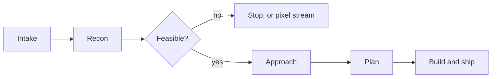

# Game to Web (G2W)

G2W (Game to Web) is a reusable agent skill for porting desktop games to the browser.

It works with Claude Code, Codex, opencode and any agent that reads the Agent Skills format. Point it at a game and it researches the build, decides what kind of port is realistic, lays out the options with a recommendation, and only starts work after you approve.


## The problem

Failed game ports usually die at the first decision, not the last compile. The engine version, the middleware, the network model and the browser's limits decide the outcome long before a build runs. G2W makes the agent settle those questions in order, with evidence, and stop for your approval before it spends hours.

## How it works

Six phases. Each one ends at a checkpoint where the agent reports what it found and waits.

| Phase | What you get |
| --- | --- |
| Intake | A clear scope: what you have and what must survive |
| Recon | A dossier: engine, middleware, assets, native-only systems |
| Feasibility | A go or no-go with every blocker and a mitigation |
| Approach | An option table plus a clear recommendation |
| Plan | Build, delivery, networking, auth, audio, testing, release |
| Ship | A build, test and deploy loop with the traps written down |



## Quick start

```bash
npx skills add Tajwarbot/game-to-web
```

Then ask:

> Can this game run in a browser? Here is the install folder. Research it and tell me what the port would take.

The agent will not touch code until you accept its feasibility verdict.

## What it knows

The value is in the specifics that real ports take time to learn:

- WebGL has no raw sockets. Networking is WebSocket over TCP or WebRTC, and that choice shows up later as jitter.
- Photon and PUN on WebGL: the built-in region pinger returns a failure code for every region, the voice client needs a valid Voice AppId, and level loads must pause the message queue or late joiners break.
- Hosting a large build: honour conditional requests so the browser reuses its IndexedDB copy instead of downloading hundreds of megabytes on every visit.
- Large games: a streamed install with content-addressed chunks, an OPFS cache, LRU eviction and wasm memory limits.
- Native games: Emscripten, WASMFS and the same streaming filesystem.
- Testing: headless browsers, two clients, a fake microphone, and long runs launched detached.

## What's inside

| File | Purpose |
| --- | --- |
| `SKILL.md` | The six phase workflow and its checkpoints. |
| `references/01-recon-and-research.md` | Where to look to identify the engine and middleware, plus the dossier template. |
| `references/02-feasibility-and-approach.md` | Decision classes, a scoring checklist, red flags and the five approaches. |
| `references/03-unity-webgl-port-playbook.md` | The Unity pipeline: reconstruction, export, the served page trap and the JS bridge. |
| `references/04-browser-platform-playbook.md` | Networking, hosting, auth, audio, input, saves and test automation. |
| `references/05-hard-won-lessons.md` | Failures that cost real time on a real port, stated as checks. |
| `references/06-worked-example-repo.md` | A completed port used as a reference shape. No identifiers. |
| `references/07-large-game-streaming.md` | Streamed installs: chunked download, OPFS cache, eviction and wasm memory limits, with a playgta5.net case study. |
| `references/08-native-wasm-port-playbook.md` | The native path: Emscripten, WASMFS, the streaming filesystem, emulator targets, and the C&C Generals and LEGO Racers case studies. |
| `references/09-sources.md` | Official docs and case studies behind the claims in this skill. |
| `references/10-plan-template.md` | A fill-in plan, the dead-end pre-mortem, and the definition of done. |
| `examples/example-session.md` | A condensed example of the output at each checkpoint. |

## Limits

It will not make an unportable game portable. Browsers have hard limits: no raw sockets, software rendering, a memory cap, and no access to Steam or the operating system. Kernel level anti-cheat and always online DRM often rule out a client side port, leaving only a streamed remote build.

It also assumes you own or are licensed to the game. The skill does not defeat DRM and does not ship proprietary assets.

## Provenance

The checklists, the traps and the playbooks come from a completed port of a co-op game to a live, password gated web build, including the multiplayer, voice and delivery work that made it playable. The worked example contains no real AppIds, endpoints or credentials.

## Contributing

Keep the phases and the checkpoints intact. Add a reference when you have a real lesson, not a guess. Contributions are welcome.

## License

MIT. See `LICENSE`.
